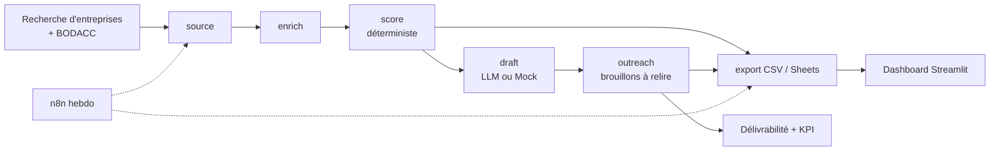

# pme-radar 📡

[](https://github.com/Mateo-MoralesLeGuillou/pme-radar/actions/workflows/ci.yml)

> **Moteur d'origination open source pour search fund français** : il transforme l'open data en une
> liste courte de PME transmissibles, notées de façon explicable, avec brouillon d'approche et
> pilotage de l'entonnoir.

- **Source** les PME d'une thèse (NAF, zone, taille) via l'API Recherche d'entreprises, avec cache et respect des limites de débit.
- **Qualifie** par un score /100 déterministe, détaillé critère par critère, et exclut les procédures collectives (BODACC).
- **Prépare** mini-thèse, signaux d'alerte et brouillon d'email par IA générative, **sans jamais toucher au score ni envoyer d'email**.
- **Pilote** l'entonnoir (identifiées → qualifiées → contactées → RDV), la délivrabilité (SPF/DKIM/DMARC) et l'export Sheets/n8n.

> ⚠️ **Statut honnête** : l'environnement de construction n'avait pas accès aux API publiques. Tout a
> été développé et testé en **mode `--offline` sur des fixtures synthétiques**. Les appels réels
> (API, Anthropic, Google Sheets, n8n) sont écrits mais **non exécutés** : voir
> [Limites](#limites-connues) et `docs/decisions.md` (ADR-001).

## Run réel (département 92, 2026-11-04) — chiffres agrégés

Run réel limité aux Hauts-de-Seine, 13 codes NAF, tranches d'effectif 10-249. Aucune donnée nominative
n'est versionnée (`data/` ignoré).

| Étape | Nombre |
|---|---:|
| Sociétés sourcées (API Recherche d'entreprises) | 343 |
| Exclues (procédure collective BODACC) | 29 |
| Notées | 314 |
| Qualifiées (score ≥ 65) | 37 (11,8 %) |

Distribution des scores (hors exclues) : médiane 38/100 ; 0-29 : 92 · 30-49 : 125 · 50-69 : 69 ·
70-100 : 28. CA publié pour 40 % des sociétés seulement ; 29 holdings personnelles de dirigeants
résolues par la requête SIREN (ADR-009). Ce run réel est distinct de l'échantillon synthétique
ci-dessous.

## Résultat d'un run type (échantillon synthétique, `--offline`)

| Étape | Nombre | Conversion vs étape précédente |
|---|---:|---:|
| Identifiées | 45 | — |
| Qualifiées (score ≥ 70) | 23 | 51 % |
| Contactées | 14 | 61 % |
| Ont répondu | 6 | 43 % |
| RDV | 1 | 17 % |

3 entreprises exclues automatiquement (procédure collective). Les étapes « contactées » et au-delà
viennent d'un suivi de campagne **fictif** (`examples/sample_campaign.csv`) ; les 14 envois sont sous
le seuil de 20 : les taux ne sont pas jugés. Exemple de ligne : *« 100/100 : dirigeant 71 ans, CA
19,0 M€, marge nette 9 %, 31 ans d'ancienneté. »*

## Architecture


Détail : [`docs/architecture.md`](docs/architecture.md).

## Démarrage rapide (sans aucune clé)

```bash
pip install -e ".[all]"
pme-radar run --offline
streamlit run dashboard/app.py
```

Le dashboard fonctionne sur `examples/sample_targets.csv` (synthétique).

## Méthodologie de scoring
100 points : **Transmission 40** (âge du dirigeant, dirigeant-exploitant, pas de successeur) · **Taille 25**
(CA, effectif) · **Qualité 20** (marge, régularité du CA, ancienneté) · **Thèse 15** (NAF cœur/adjacent),
moins pénalités (dirigeant personne morale −10, comptes absents −5). Procédure collective = exclusion.
Une donnée manquante n'est jamais un zéro : 0 point + mention « n.d. ». Détail et limites :
[`docs/scoring_methodology.md`](docs/scoring_methodology.md).

## Configuration

| Fichier | Rôle |
|---|---|
| `config/thesis.yaml` | NAF (cœur/adjacent), tranches d'effectif, départements, état |
| `config/scoring.yaml` | Barèmes, seuil de qualification, nombre de cibles passées à l'IA |
| `config/campaign.yaml` | Seuils d'alerte rebonds / réponses / RDV |
| `.env` (copie de `.env.example`) | **Optionnel** : `ANTHROPIC_API_KEY`, `GOOGLE_APPLICATION_CREDENTIALS`, `GOOGLE_SHEET_ID` |

Commandes : `source`, `enrich`, `score`, `draft [--llm mock|anthropic]`, `export`, `run`,
`track <SIREN> <statut>`, `deliverability --domain … [--selector …]`.

## Conformité RGPD et éthique d'approche
`data/` non versionné, échantillon synthétique, minimisation des données envoyées au LLM, **aucun envoi
automatique** : seulement des brouillons « À RELIRE », un droit d'opposition tracé, un ton respectueux
sans pression ni prix. Voir [`docs/rgpd.md`](docs/rgpd.md) (pas un avis juridique).

## Limites connues
- **Appels API réels non testés** (réseau bloqué lors de la construction) : noms de paramètres à
  confirmer au premier run (`docs/runbook.md`).
- Codes NAF vérifiés de mémoire, pas contre le référentiel INSEE ; NAF 2025 à intégrer début 2027.
- Provider Anthropic, Google Sheets et workflow n8n non exécutés en réel.
- « Groupe » détecté via la société dirigeante (holding personnelle = NAF 64.20Z dirigée par une personne physique, sinon pénalisée) : une holding de fondateur d'un autre NAF reste pénalisée (ADR-009).
- Ratios INPI/BCE (EBE, dette) non branchés. Pondérations non apprises.

## Feuille de route
Scraping des sites web des cibles (taille réelle, clients, offres d'emploi) · détection de signaux de
cession (annonces légales, ventes d'actifs, changement de dirigeant) · intégration CRM · scoring appris
sur les RDV obtenus · ratios INPI/BCE · bénéficiaires effectifs pour mieux détecter les groupes.

## Documentation
[Runbook (reprise en 30 min + warm-up)](docs/runbook.md) · [Walkthrough pédagogique + 10 questions d'entretien](docs/walkthrough.md) ·
[Décisions](docs/decisions.md) · [Memo sectoriel](memo/memo_sectoriel.md) · [n8n](n8n/README.md) · [Plan](PLAN.md)

## Méthode
Projet construit en développement assisté par IA (Claude Code), **conçu, piloté et vérifié par
l'auteur** : cadrage de la thèse et du scoring, choix d'architecture consignés en ADR, relecture du code
et des tests, et signalement explicite de ce qui n'a pas pu être vérifié.
