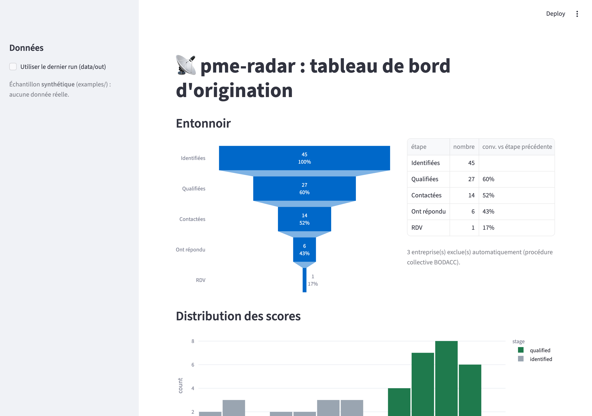
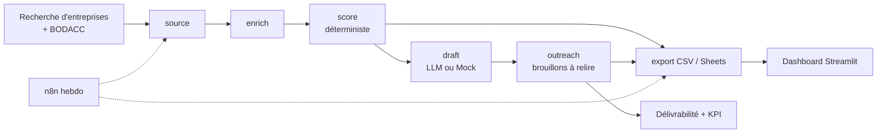

# pme-radar 📡

[](https://github.com/Mateo-MoralesLeGuillou/pme-radar/actions/workflows/ci.yml)




*Captures du dashboard sur l'échantillon **synthétique** (`examples/`).*

> **Moteur d'origination open source pour search fund français** : il transforme l'open data en une
> liste courte de PME transmissibles, notées de façon explicable, avec brouillon d'approche et
> pilotage de l'entonnoir.

- **Source** les PME d'une thèse (NAF, zone, taille) via l'API Recherche d'entreprises, avec cache et respect des limites de débit.
- **Qualifie** par un score /100 déterministe, détaillé critère par critère, et exclut les procédures collectives (BODACC).
- **Prépare** mini-thèse, signaux d'alerte et brouillon d'email par IA générative, **sans jamais toucher au score ni envoyer d'email**.
- **Pilote** l'entonnoir (identifiées → qualifiées → contactées → RDV), la délivrabilité (SPF/DKIM/DMARC) et l'export Sheets/n8n.

> ✅ **Statut honnête** : le pipeline a été **exécuté en réel** le 2026-11-04 sur le département 92
> (API Recherche d'entreprises, BODACC, ratios BCE/INPI) ; les paramètres et champs sont confirmés (voir
> [`PLAN.md`](PLAN.md)). **Non exécutés en réel** : provider Anthropic, Google Sheets, workflow n8n.
> Le mode `--offline` (fixtures synthétiques) reste la référence des tests et de la CI.

## Run réel (département 92, 2026-11-04) — chiffres agrégés

Run limité aux Hauts-de-Seine, 13 codes NAF, tranches d'effectif 10-249. Aucune donnée nominative n'est
versionnée (`data/` ignoré). Distinct de l'échantillon synthétique ci-dessous.

| Étape | Nombre |
|---|---:|
| Sociétés sourcées (API Recherche d'entreprises) | 343 |
| Exclues (procédure collective BODACC) | 29 |
| Notées | 314 |
| Qualifiées (score ≥ 70) | 35 (11,1 %) |

Distribution des scores (hors exclues), médiane 41/100 : 0-29 : 85 · 30-49 : 112 · 50-69 : 82 · 70-100 : 35.
Couverture des données : CA connu pour 48 % des sociétés, EBE pour 44 %, CAGR pour 36 % (sans les ratios
INPI : CA 40 %, EBE 0 %, CAGR 0 %). 29 holdings personnelles résolues via ADR-009. Seuil de 70 conservé :
voir ADR-011.

## Résultat d'un run type (échantillon synthétique, `--offline`)

| Étape | Nombre | Conversion vs étape précédente |
|---|---:|---:|
| Identifiées | 45 | — |
| Qualifiées (score ≥ 70) | 27 | 60 % |
| Contactées | 14 | 52 % |
| Ont répondu | 6 | 43 % |
| RDV | 1 | 17 % |

3 entreprises exclues automatiquement (procédure collective). Les étapes « contactées » et au-delà
viennent d'un suivi de campagne **fictif** (`examples/sample_campaign.csv`) ; les 14 envois sont sous
le seuil de 20 : les taux ne sont pas jugés. Exemple de ligne : *« 100/100 : dirigeant 71 ans, CA
19,0 M€, marge d'EBE 11 %, 31 ans d'ancienneté. »*

## Architecture


Détail : [`docs/architecture.md`](docs/architecture.md).

## Démarrage rapide (sans aucune clé)

```bash
pip install -e ".[all]"
pme-radar run --offline
streamlit run dashboard/app.py
```

Le dashboard fonctionne sur `examples/sample_targets.csv` (synthétique).

## Méthodologie de scoring
100 points : **Transmission 40** (âge du dirigeant, dirigeant-exploitant, pas de successeur) · **Taille 25**
(CA, effectif) · **Qualité 20** (marge d'EBE, repli marge nette ; régularité du CA, ancienneté) · **Thèse 15** (NAF cœur/adjacent),
moins pénalités (dirigeant personne morale −10, comptes absents −5). Procédure collective = exclusion.
Une donnée manquante n'est jamais un zéro : 0 point + mention « n.d. ». Détail et limites :
[`docs/scoring_methodology.md`](docs/scoring_methodology.md).

## Configuration

| Fichier | Rôle |
|---|---|
| `config/thesis.yaml` | NAF (cœur/adjacent), tranches d'effectif, départements, état |
| `config/scoring.yaml` | Barèmes, seuil de qualification, nombre de cibles passées à l'IA |
| `config/campaign.yaml` | Seuils d'alerte rebonds / réponses / RDV |
| `.env` (copie de `.env.example`) | **Optionnel** : `ANTHROPIC_API_KEY`, `GOOGLE_APPLICATION_CREDENTIALS`, `GOOGLE_SHEET_ID` |

Commandes : `source`, `enrich`, `score`, `draft [--llm mock|anthropic]`, `export`, `run`,
`onepager [--siren … | --top-n …]` (fiche cible + fourchette de valorisation, exemple : [`examples/onepager_sample.md`](examples/onepager_sample.md)), `track <SIREN> <statut>`, `deliverability --domain … [--selector …]`.

## Conformité RGPD et éthique d'approche
`data/` non versionné, échantillon synthétique, minimisation des données envoyées au LLM, **aucun envoi
automatique** : seulement des brouillons « À RELIRE », un droit d'opposition tracé, un ton respectueux
sans pression ni prix. Voir [`docs/rgpd.md`](docs/rgpd.md) (pas un avis juridique).

## Limites connues
- **Testé en réel sur un seul département (92)** ; les 7 autres départements d'Île-de-France n'ont pas été
  lancés. Le quota de l'API Recherche d'entreprises (redirection 302 « sorry ») impose 2 req/s.
- **Données financières partielles** : ~50 % des sociétés ne publient pas leur CA (`ca: 0`), l'API ne
  fournit qu'un exercice ; l'historique et l'EBE viennent du jeu INPI, parfois ancien (bilans > 4 ans
  écartés) et masqué pour les bilans confidentiels. Sans EBE : repli sur la marge nette.
- **Valorisation** : EBE × multiples configurables, pur ordre de grandeur (ni dette nette, ni BFR, ni EBE normalisé).
- **Holdings** : une holding de fondateur d'un autre NAF que 64.20Z reste pénalisée comme « groupe » (ADR-009) ;
  sur le run réel, 58 sociétés dirigées par une société non-holding à dirigeant personne physique sont dans ce cas.
- Procédures collectives BODACC : toute annonce de famille « collective » exclut, y compris ancienne ou clôturée.
- NAF 2025 applicable au 01/01/2027 : l'API expose `activite_principale_naf25`, non encore utilisée.
- Provider Anthropic, Google Sheets et workflow n8n non exécutés en réel. Pondérations non apprises.

## Feuille de route
Scraping des sites web des cibles (taille réelle, clients, offres d'emploi) · détection de signaux de
cession (annonces légales, ventes d'actifs, changement de dirigeant) · intégration CRM · scoring appris
sur les RDV obtenus · endettement INPI dans le score · bénéficiaires effectifs pour mieux détecter les groupes.

## Documentation
[Runbook (reprise en 30 min + warm-up)](docs/runbook.md) · [Walkthrough pédagogique + 10 questions d'entretien](docs/walkthrough.md) ·
[Décisions](docs/decisions.md) · [Memo sectoriel](memo/memo_sectoriel.md) · [n8n](n8n/README.md) · [Plan](PLAN.md)

## Méthode
Projet construit en développement assisté par IA (Claude Code), **conçu, piloté et vérifié par
l'auteur** : cadrage de la thèse et du scoring, choix d'architecture consignés en ADR, relecture du code
et des tests, et signalement explicite de ce qui n'a pas pu être vérifié.
