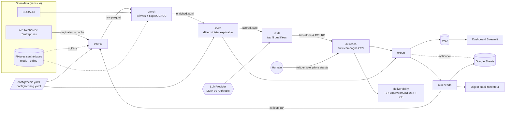

# Architecture

## Flux de données
| Étape | Entrée | Sortie |
|---|---|---|
| `source` | thèse, API | `data/raw/companies.parquet` |
| `enrich` | raw, BODACC | `data/processed/enriched.jsonl` |
| `score` | enriched, scoring.yaml | `data/processed/scored.jsonl` |
| `draft` | scored, LLM | `analyzed.jsonl`, `out/drafts.csv`, `out/campaign.csv` |
| `export` | analyzed, campaign | `out/{identified,qualified,contacted,meeting,funnel}.csv` (+ Sheets) |

## Principes
1. Chaque étape lit/écrit un fichier : reprise possible après n'importe quelle étape.
2. Tout ce qui peut changer sans toucher au code est en YAML.
3. Toute dépendance externe (API, LLM, Sheets) est injectable et remplaçable par un mock.
4. Le dossier `data/` (potentiellement nominatif) n'est jamais versionné.
